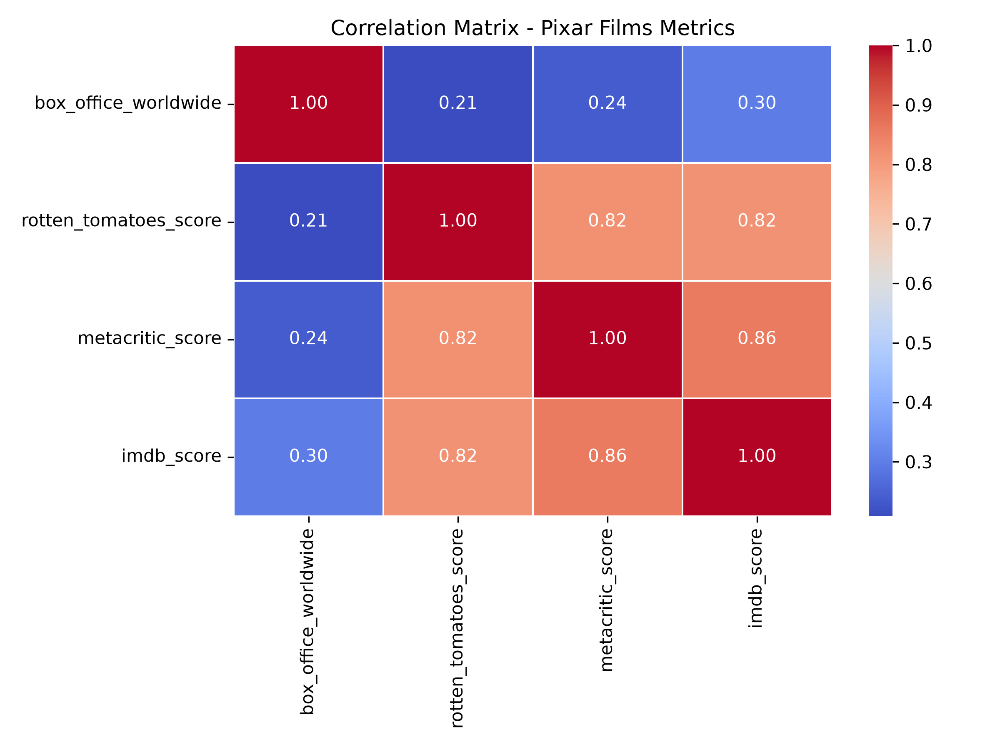

# Pixar Films Statistical & Exploratory Data Analysis

Exploratory Data Analysis (EDA) on 28 Pixar animated feature films, examining the relationship between critical reception (Rotten Tomatoes, Metacritic), audience ratings (IMDb), and worldwide box office performance.



## Key Features
- **Descriptive Statistics:** Computes mean, median, mode, range, and standard deviation across key performance metrics.
- **Distribution Analysis:** Generates histograms and box plots to identify skewness and outliers in revenue and review scores.
- **Correlation Analysis:** Evaluates linear relationships between critical acclaim and commercial success via a correlation heatmap.

## Key Insights
- **Critics vs. Audience:** Rotten Tomatoes, Metacritic, and IMDb scores show a strong positive correlation with each other.
- **Ratings vs. Revenue:** High critical scores do not strictly guarantee higher worldwide box office revenue, indicating the influence of release timing, franchise recognition, and external market factors.

## Project Structure
- `data/pixar_films.xlsx` — Dataset containing financial and rating metrics for Pixar films.
- `src/analysis.py` — Python script for statistical computations and data visualization.
- `images/` — Generated plots and correlation heatmaps.

## How to Run
1. Clone the repository:
   ```bash
   git clone [https://github.com/Dan1ny3/pixar-films-analysis.git](https://github.com/Dan1ny3/pixar-films-analysis.git)
   cd pixar-films-analysis
